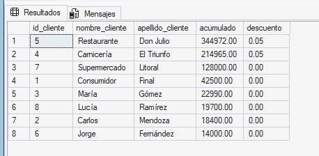
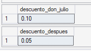
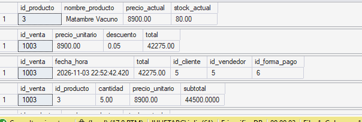
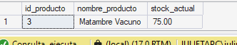

# Tema 1: Procedimientos y funciones almacenadas

## 1. Definición y objetivo

Un **procedimiento almacenado** es un conjunto de sentencias T-SQL que se guarda con nombre dentro de la base de datos y se ejecuta con `EXEC`. Puede recibir parámetros, consultar y modificar varias tablas, manejar transacciones y devolver resultados.

Una **función almacenada** es una rutina que recibe parámetros y devuelve un valor (función escalar) o una tabla. A diferencia del procedimiento, no puede modificar datos de las tablas, y por eso puede usarse dentro de un `SELECT`, un `WHERE` o como parte de otra expresión.

El objetivo de ambos es guardar la lógica de negocio dentro de la base, en un único lugar, para que cualquier aplicación o usuario la reutilice sin reescribirla.

## 2. Ventajas y aplicaciones

- **Reutilización:** la regla se escribe una sola vez y se invoca las veces que haga falta. En nuestro caso, el procedimiento de ventas usa la función de descuento en lugar de repetir su cálculo.
- **Menos código repetido y más mantenibilidad:** si cambia la regla del descuento, se modifica solo la función.
- **Reglas de negocio centralizadas:** registrar una venta exige varios pasos en un orden fijo. El procedimiento garantiza que siempre se hagan todos y en ese orden.
- **Seguridad:** se puede permitir a un usuario ejecutar el procedimiento sin darle permiso para modificar las tablas directamente (se desarrolla en el Tema 4).
- **Aplicaciones típicas:** alta de operaciones que tocan varias tablas (ventas, compras), cálculos reutilizables (descuentos, impuestos, totales) y reportes parametrizados.

## 3. Implementación en SQL Server Express

**Función escalar:**

```sql
CREATE OR ALTER FUNCTION esquema.nombre (@parametro TIPO)
RETURNS TIPO
AS
BEGIN
    -- lógica
    RETURN valor;
END;
```

Se invoca siempre con el esquema: `SELECT dbo.nombre(valor);`.

**Procedimiento almacenado:**

```sql
CREATE OR ALTER PROCEDURE esquema.nombre
    @parametro1 TIPO,
    @parametro2 TIPO
AS
BEGIN
    SET NOCOUNT ON;
    -- sentencias
END;
```

Se ejecuta con `EXEC esquema.nombre @parametro1 = valor, @parametro2 = valor;`.

`CREATE OR ALTER` crea el objeto o lo reemplaza si ya existe, lo que permite volver a ejecutar el script sin errores. Cada `CREATE FUNCTION` o `CREATE PROCEDURE` debe ser la primera sentencia de su lote, por eso se separa con `GO`.

## 4. Caso concreto aplicado al frigorífico

### Función `dbo.fn_CalcularDescuentoCliente`

**Problema de negocio:** el frigorífico quiere premiar a los clientes que más compran, sobre todo a los mayoristas (restaurantes, carnicerías, supermercados).

**Regla:** según el monto acumulado de compras del cliente:

| Monto acumulado | Descuento |
| --- | --- |
| Más de $500.000 | 10% (0.10) |
| Más de $200.000 | 5% (0.05) |
| Resto | 0% (0.00) |

**Funcionamiento:** suma `VENTA.total` de todas las ventas del cliente y, con un `CASE`, devuelve el porcentaje como fracción. Decisiones:

- Se suma `VENTA.total` porque la consulta no hace JOIN con `DETALLE_VENTA`, así que cada venta se cuenta una sola vez.
- `ISNULL(SUM(total), 0)`: `SUM` sobre cero filas devuelve `NULL`, no 0. Para un cliente sin compras el acumulado queda en 0.
- Los `WHEN` van del tramo más alto al más bajo, porque el `CASE` se queda con la primera condición verdadera.
- Se usa `>` porque la regla dice "más de".
- Devuelve 0.10 y no 10 para poder aplicarlo directo: `total × (1 − descuento)`.

Script: [`sql/tecnico/Funciones/01_funcion_descuento.sql`](../../../sql/tecnico/Funciones/01_funcion_descuento.sql)

### Procedimiento `dbo.sp_RegistrarVentaCompleta`

**Problema de negocio:** registrar una venta exige consultar el precio, calcular el descuento, insertar el encabezado, insertar el detalle y actualizar el stock. Hacerlo con sentencias sueltas es lento y permite errores, como olvidar un paso o dejar una venta sin detalle.

**Parámetros:** `@id_cliente`, `@id_vendedor`, `@id_forma_pago`, `@id_producto`, `@cantidad`.

**Pasos que realiza:**

1. Lee `PRODUCTO.precio_actual`. Ese valor se guarda en `DETALLE_VENTA.precio_unitario` como **precio histórico**, de modo que un aumento posterior no altera la venta. Si el producto no existe, informa el error y termina.
2. Calcula el descuento con `dbo.fn_CalcularDescuentoCliente`, antes de registrar la venta, para que la venta actual no cuente para su propio descuento.
3. Calcula el total: `cantidad × precio × (1 − descuento)`, redondeado a 2 decimales.
4. Dentro de una transacción inserta el encabezado en `VENTA` y recupera el `id_venta` generado con `SCOPE_IDENTITY()`.
5. Inserta el renglón en `DETALLE_VENTA`. Al hacerlo se dispara el trigger `TR_DETALLE_VENTA_CONTROL_STOCK`, que verifica el stock y lo descuenta. El procedimiento no actualiza el stock por su cuenta, porque se descontaría dos veces.
6. Confirma con `COMMIT`. Si cualquier paso falla, el bloque `CATCH` deshace todo con `ROLLBACK` y devuelve el error original con `THROW`.

**Decisión de diseño:** el descuento se aplica sobre `VENTA.total`, mientras que `DETALLE_VENTA.subtotal` conserva el importe a precio de lista. Por eso, en las ventas con descuento, el total de la venta es menor que la suma de su detalle.

**Limitación:** el procedimiento registra un producto por venta. Para varios renglones habría que recibir una tabla como parámetro (*table-valued parameter*).

Script: [`sql/tecnico/Procedimientos/02_sp_registrar_venta.sql`](../../../sql/tecnico/Procedimientos/02_sp_registrar_venta.sql)

## 5. Script de demostración y resultados obtenidos

### Función: descuento de cada cliente

Con los datos de prueba, ningún cliente supera $500.000. Restaurante Don Julio ($344.972) y Carnicería El Triunfo ($214.965) obtienen 5%, y el resto 0%.



### Función: tramo del 10%

Para mostrar el tramo más alto sin alterar los datos, dentro de una transacción se inserta una venta de $200.000 a Don Julio (acumulado $544.972), se consulta la función y se deshace con `ROLLBACK`. La función devuelve 0.10 dentro de la transacción y vuelve a 0.05 después del `ROLLBACK`, lo que confirma que la venta de prueba no quedó guardada.



### Procedimiento: venta de 5 kg de Matambre a Restaurante Don Julio

```sql
EXEC dbo.sp_RegistrarVentaCompleta
     @id_cliente = 5, @id_vendedor = 5, @id_forma_pago = 6,
     @id_producto = 3, @cantidad = 5;
```

| Qué se verifica | Antes | Después |
| --- | --- | --- |
| Stock de Matambre Vacuno | 80,00 kg | 75,00 kg |
| Venta registrada | no existe | total $42.275,00, cliente 5, vendedor 5, forma de pago 6 |
| Detalle | no existe | 5 kg × $8.900,00 = subtotal $44.500,00 |
| Descuento aplicado | | 0.05 |

Cálculo: 5 × 8.900 = 44.500; 44.500 × 0,95 = 42.275. Con una sola instrucción quedaron registrados el encabezado, el detalle con el precio histórico y el descuento, y el trigger actualizó el stock.





**Nota sobre el número de venta:** la venta quedó con `id_venta = 1003` y no 9. No es un error. SQL Server reserva valores de `IDENTITY` en bloques de 1000, y cuando el servicio se reinicia descarta los que no usó, así que la numeración salta. `IDENTITY` garantiza valores únicos, no consecutivos.
